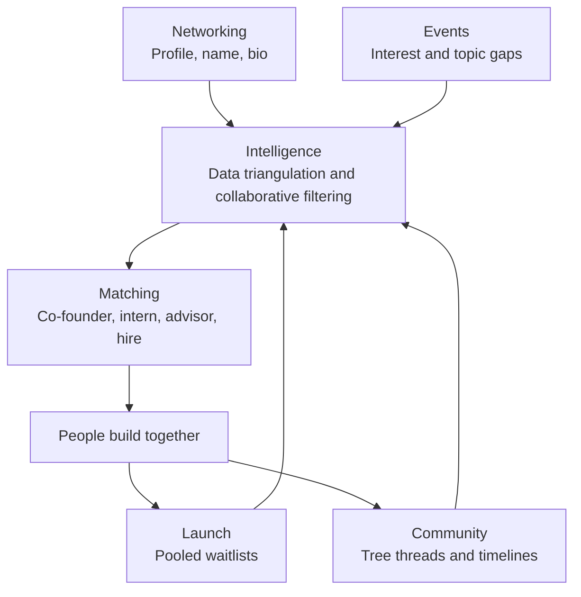

# Eniversal Vision

*Nov 1, 2026*

## The vision

Eniversal is where India's student builders find their people, ideas and first believers.

Each platform today owns one piece of the journey. LinkedIn owns networking, Reddit owns deep conversation, Tinder owns matching, launch platforms own anticipation, and Unstop owns events. We take the best part of each and connect them, so that everything a person does makes their next match and launch better.

**The promise:** you don't just join Eniversal. You feel that you are inside something and attached to it.

## Who it is for

Students are the major audience and the people who actually build. Everyone else makes the student's work matter.

| Audience | Role on Eniversal | What they come for |
| --- | --- | --- |
| Students | Performing audience: they build | Co-founders, feedback, events, visibility, a first launch |
| Working professionals | Active audience | Ideas, side projects, advising, joining early |
| Workers | Active audience | Contributing from the start, or joining if an idea succeeds |
| Investors | Active audience | Early sight of ideas and of who is really building |
| Idea seekers | Active audience | Problems and gaps worth working on |

## What we are stealing

| From | We steal | How Eniversal uses it |
| --- | --- | --- |
| LinkedIn | Networking, end to end | A familiar profile that can be judged in a minute |
| Reddit | Deep convos, organic matching, bonding | Community-led threads that build belonging |
| Tinder | Matching | Matching people for roles, not dates |
| Indie Hackers, Whop, TrustMRR | Launch mechanics | Waitlists, notifications and anticipation |
| Unstop | Events, interest and build-up | Events that also reveal what people care about |

Data triangulation and collaborative filtering connect all of them. That connection is the part nobody else has.

## The six pillars

### 1. Networking, stolen from LinkedIn

We want LinkedIn's networking done end to end, and we keep its UX and UI patterns because people have already adapted to them. Nobody should have to learn how to read a profile.

The first screen shows **profile picture, name and bio**. That is enough to form a view of someone in a minute.

> We can't absolutely say yes from that first look, but we can definitely say no.

This is the core design rule. The first screen exists to make a confident no fast, and everything deeper exists to earn the yes.

### 2. Community, stolen from Reddit

We take the deep convos, the organic matching that happens in them and the way they bond people. We keep Reddit's concept and give it a different UX. The aim is the best community-led flow in the app, where people feel involved rather than like an audience.

**Threads grow as trees and move through time.** Tags connect every thread to its topic, so anyone can see how a conversation develops over the following months.

For example, an incident involving Mark Zuckerberg happens in March 2027. The topic then shows threads from June, July and August, each with a different approach or perspective on that same incident.

This requires:

- Tags that link threads across time, as in Threads.
- Tree structures that show how the conversation branches.
- A timeline view of how a topic has moved.

### 3. Intelligence: triangulation and collaborative filtering

Everything we take from LinkedIn and Reddit becomes signal. Data triangulation reads all explicit and implicit data together and reduces it to a few clear results. Collaborative filtering then finds the best matches from those results.

| Signal type | Meaning | Examples |
| --- | --- | --- |
| Explicit | What people state | Bio, skills, tags followed, roles wanted, waitlists joined, event registrations |
| Implicit | What people do | Threads read and replied to, depth of conversation, profiles passed on, topics returned to |

A person's claims can be checked against their behaviour, which makes a match more trustworthy than a profile alone.

### 4. Matching, stolen from Tinder

Tinder's mechanic comes last because it depends on the data from the pillars before it. People match for any role that needs filling:

- Co-founder
- Intern
- Involvement or contributor
- Advisor
- Hiring
- Anyone looking for a new approach to a problem

The LinkedIn first screen is the natural match card: picture, name, bio, and a fast no. A match can then open onto the threads, projects and events behind that person, which is what earns the yes.

### 5. Launch, stolen from Indie Hackers, Whop and TrustMRR

Any builder should be able to create the anticipation that a properly marketed startup gets. An idea can gather collaborative power from the moment its builder announces it, before the app exists.

The feature set includes the waitlist, a notification strategy and the features that launching an app needs.

**The pooled waitlist** is one waitlist that gathers everyone an idea needs:

| Who joins | Why they join |
| --- | --- |
| Users | They want the product |
| Workers | They want to contribute from the start, or to work on it if it succeeds |
| Investors | They want early sight of it |
| Other people | They have some other stake in the idea |

**It must not feel like filling out a Google Form.** It should feel like something you are already involved in. We take inspiration from existing launch platforms and build it our own way, so that Indians feel the most involved.

### 6. Events, stolen from Unstop

Events bring students in and build interest. They also tell us something no profile can: which topics people care about right now.

Take an event called **AI agents for cybersecurity**. Its registrations show a pool of people ready for that subject. We can then see how volatile the topic is and compare that interest with what is being built:

| What the data shows | What it means |
| --- | --- |
| People are interested, but nobody is building a startup | An open gap |
| People are building, but the startups are not good | Room for a better attempt |
| Something else stands out in the data | A different edge to pursue |

Events therefore serve builders twice: they meet their people there, and they learn where the opportunity is.

## How it all connects

Each launch and conversation adds signal, better signal makes better matches, and better matches produce more builders and launches. That loop is the moat.

## Product principles

1. **Steal the familiar, change what matters.** Keep LinkedIn's patterns where habit helps. Build a new UX where the experience should feel different, as with threads.
2. **Make the no fast and earn the yes.** Respect people's time on the first screen, then give depth to whoever passes it.
3. **Involvement over forms.** Every action, even joining a waitlist, should feel like taking part.
4. **Everything is signal.** Each feature should help people directly and also improve matching.
5. **Built for how Indian students build.** Students are the builders, and everyone else gathers around their work.

## To confirm

I interpreted or filled in these points, so please correct any that are wrong:

- **"Oral matching":** I wrote this as "organic matching". It may have been a speech-to-text error.
- **"Trustmr":** I took this to mean TrustMRR.
- **"Greatets":** I took this as a request for your greatest vision doc, not as a term to include.
- **Signal examples:** you described explicit and implicit data, and the specific examples in the table are mine.
- **Match card and loop:** using the first screen as the match card, and the loop back from matches to launches and threads, are my connections.
- **Name:** I kept "Eniversal". Please confirm the spelling.

## Raw notes

The founder's original words, unedited.

regarding linkedin all we want from linkedin is to get the networking part done end to end. we are going to steal networking from linkedin. we are already adapted to linkedin's ux and ui. by the time we go to the first screen, we know the profile picture, the name, and the bio. that way we can make something up in our minds about that profile in just a minute. we can not absolutely say yes but we can definitely say no if it is so. we are sealing that from link

we are stealing the deep convos, the oral matching, and the bonding structure in technology, using reddit's ux functioning. you want to introduce the best community-led or community-involved flow to be happening in the app that we are building. also you want tagging us just like threads so that we know how the conversation is going down the line in the next 2 months: threads, the timeline.

let's say there is some incident that has happened with mark zuckerberg in march of 2027. then we're going to see threads of june, july, and august regarding different approaches, different perspectives on the same topic. we need threads, we need tree-like structures, a different ux from reddit but the whole concept is the same.

you want to be completely involved, you want to completely feel inside. you want to feel that we are inside something, that we are attached to something. that is what we are stealing from reddit

from the things that we have extracted and stolen from reddit and linkedin (the networking, the involvement, and deep convos), we are going to use data triangulation on all the signals, all the data, and all the explicit and implicit data towards a few result mechanisms. we are also going to use collaborative filtering to find out the best outcomes that we can match with.

then we introduce tinder where we are going to match people for a co-founder role, an intern role, an involvement role, or any role that is to be taken care of (when you are hiring, looking out for approaches, looking out for advisors, or anything). that is the thing. this is the whole concept that i have in my mind

then we are also adding a feature set to launch apps like indie hacker and whop. we need the waitlist, the notification strategy, and the feature set of this whole thing. we want to build the anticipation just like we build for actual marketed startups. we need collaborative power to drive in when we are actually announcing that we are going to build this app.

when we put up the waitlist, we need it for users. we need it for workers who are interested in working if that idea becomes a success or who want to contribute from the start itself. we need it for investors and for different kinds of people.

we need a pooled waitlist ux that does not feel like filling out a google form but feels like something that you are already involved in. that is the thing. take inspiration from existing launching platforms like trustmr etc. but build it in our way so that indians would feel the most involvedness out of all of this thing

and then because the major audience of this whole concept that we're building are students, and the most performing audience are students. the active audience could be investors, workers, working professionals, people who are looking out for ideas but the performing audience regarding building are students. i would want the whole event space that is to be in the concept of this app, right, that's like unstop from this what we get is the interest and build-upness. let's say there's an event that is being conducted on the title of ai agents for cybersecurity. we know these kinds of pools are ready for cybersecurity matters, right? you know the interests of the people, right? you know the volatility of a topic from this data: certain people are interested in this topic. people are not building a startup regarding this topic or people are building a startup regarding this topic and the startups are not good. or you find a different edge, you find a different gap, right?

so get me a new vision doc md in my downlaods rn , greatets
